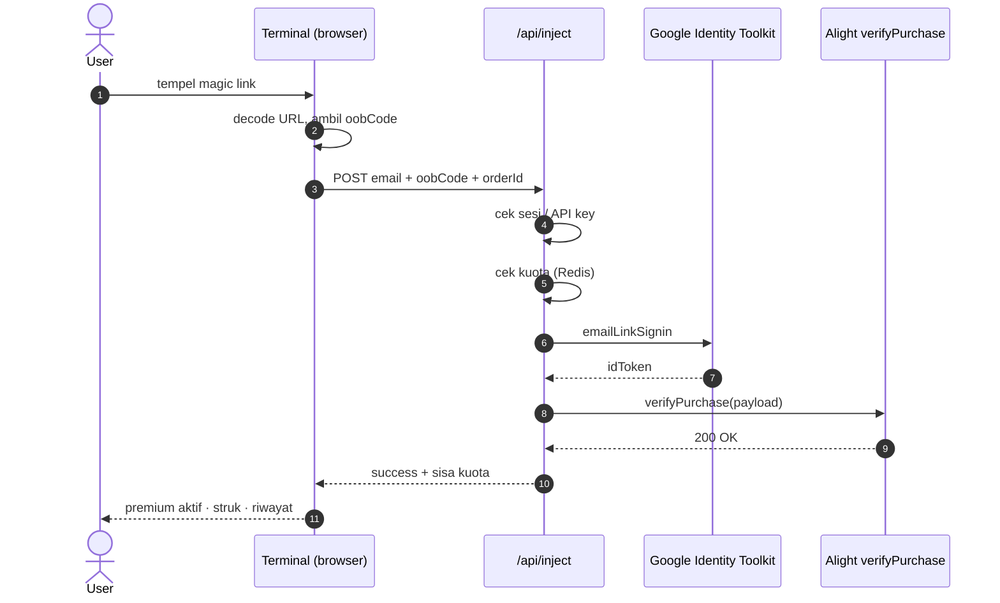

```
   ▄▀█ █▀▄▀█   █▀█ █▀█ █▀▀ █▀▄▀█ █ █ █ █▀▄▀█
   █▀█ █░▀░█   █▀▀ █▀▄ ██▄ █░▀░█ █ █ █ █░▀░█
   ─────────────────────────────────────────────
   ZUKAI TERMINAL · v5.2.0 · node asia-se-01 · READY
```

# AM PREMIUM // ZUKAI TERMINAL

**Alight Motion Premium tanpa drama.** Terminal serverless buat aktivasi Alight Motion Premium — plus workspace Lab buat shell, downloader, dan temp mail. Semua logika berat di server, browser tetap bersih.

[](https://www.juikoprem.my.id/)
[](https://github.com/kyedeveloper/am-premium)
[](https://vercel.com/)
[](https://developer.mozilla.org/en-US/docs/Web/JavaScript)
[](https://upstash.com/)
[](https://github.com/kyedeveloper/am-premium#-lisensi)

[Demo Langsung](https://www.juikoprem.my.id/) · [Fitur](#-kapabilitas) · [Lab](#-lab-workspace) · [Cara Kerja](#-cara-kerja) · [API](#-api-reference) · [Deploy](#-deploy-sendiri) · [FAQ](#-faq)

> Bukan produk resmi Alight Creative. Kalau premium tiba-tiba hilang, jalankan ulang prosesnya.

---

## 📑 Daftar Isi

| # | Bagian | # | Bagian |
|---|---|---|---|
| 1 | [Apa ini](#-apa-ini) | 7 | [API Reference](#-api-reference) |
| 2 | [Spesifikasi](#-spesifikasi) | 8 | [Model Data](#%EF%B8%8F-model-data) |
| 3 | [Kapabilitas Terminal](#-kapabilitas-terminal) | 9 | [Deploy Sendiri](#-deploy-sendiri) |
| 4 | [Lab Workspace](#-lab-workspace) | 10 | [Keamanan](#-keamanan) |
| 5 | [Cara Kerja](#-cara-kerja) | 11 | [Batasan & Roadmap](#%EF%B8%8F-batasan) |
| 6 | [Struktur Proyek](#-struktur-proyek) | 12 | [FAQ](#-faq) · [Kontribusi](#-kontribusi) · [Lisensi](#-lisensi) |

---

## 📟 Apa ini

**AM Premium** memangkas alur aktivasi premium manual jadi **dua kolom input dan satu tombol**.

Proses aslinya panjang dan gampang salah: kirim link verifikasi, buka email, salin URL panjang yang berantakan, tempel ke tempat yang benar, baru jalankan. Terminal ini memotong semuanya.

Seluruh logika berat — login OOB, pemanggilan `verifyPurchase`, penyimpanan token, hitung kuota — dipindah ke serverless function. **Prinsip desainnya: satu layar, dua langkah, nol token di frontend.** Kalau satu langkah gagal, terminal bilang persis di mana masalahnya.

Sejak v5.2.0 ada **Lab Workspace**: shell sandbox, downloader multi-platform, dan temp mail multi-provider — semuanya dalam satu terminal yang sama.

---

## 🧾 Spesifikasi

|  |  |
|---|---|
| **Developer** | Zukai Dev |
| **Runtime** | Vercel Functions (node `asia-se-01`) |
| **Stack** | HTML + Vanilla JS, tanpa framework, tanpa build step |
| **Data** | Upstash Redis (REST) |
| **Auth** | Session JWT (cookie `HttpOnly`) + API key `x-api-key` |
| **Pembayaran** | QRIS via Pixpayz |
| **Sandbox** | Piston API (bash / node / python / 11 bahasa) |
| **Downloader** | cobalt · tikwm · oceansaver |
| **Temp Mail** | tempmail.plus · guerrillamail · mail.tm · mail.gw · maildrop.cc · 1secmail |
| **Versi** | v5.2.0 · Build 2026.11.01 |
| **Lisensi** | Open Source |

---

## ⚡ Kapabilitas Terminal

Dibangun buat dipakai, bukan dipamerin. Tiap bagian punya satu tugas jelas.

### 1. Magic Link Dispatch
Kirim email verifikasi ke akun target lewat `POST /api/magic-link`. Respon langsung, tanpa reload. Rate limit 40 request/jam per IP.

### 2. Bulk Antrian
Tempel sampai 30 email sekaligus, dikirim berurutan dengan jeda 1,2 detik. Status per baris terlihat jelas — sukses, gagal, atau menunggu.

### 3. Validator Realtime
Tempel link, langsung dicek: `oobCode` ketemu atau tidak, panjang karakter, dan tombol inject menyesuaikan. Parser mendekode URL bersarang dan cuma mengambil nilai `oobCode`.

### 4. Force Inject
Payload diteruskan ke `POST /api/inject` dengan order ID unik sebagai jejak aktivasi. Butuh sesi login atau API key yang valid.

### 5. Akun & Kuota Server
Register/login pakai email + password (bcrypt, cost 10). Kuota **20 inject/hari** buat akun free, reset 00:00 WIB. Dihitung di Redis, bukan di browser — nggak bisa diakalin lewat DevTools.

### 6. Premium & QRIS Otomatis
Upgrade Rp3.500 / 30 hari. Invoice dibuat lewat Pixpayz, QR dirender di sheet pembayaran, status di-polling sampai lunas, plan naik otomatis tanpa kirim bukti transfer.

### 7. API Key buat Bot
Setiap akun punya API key `am_<48 hex>`. Bisa dirotasi dari panel akun. Dipakai sebagai header `x-api-key` buat integrasi mesin.

### 8. Riwayat Lokal + CSV
Aktivasi tersimpan di `localStorage` perangkat, bisa diekspor CSV buat pembukuan, bisa dihapus kapan saja.

### 9. Panel Owner
Statistik global, grant premium manual per email, banner pengumuman global, dan saklar maintenance mode.

### 10. Token di Server
`API_KEY`, `ALIGHT_TOKEN`, `FIREBASE_TOKEN`, `JWT_SECRET`, `PIXPAYZ_API_KEY` hidup sebagai env Vercel. Nol kredensial di HTML.

### Ekstra terminal
`Ctrl+K` command palette · accent themes (violet/cyan/lime/ember) · sound toggle (Web Audio, tanpa file) · QR share · confetti + particle canvas · navigasi keyboard `↑ ↓ Enter Esc` · order ID acak atau urut · sheet konfirmasi + struk unduhan · mini tools (OOB extractor, Base64, epoch clock) · responsive + reduced-motion.

---

## 🧪 Lab Workspace

Workspace tab terpisah — `Beranda` · `Shell` · `Downloader` · `Temp Mail` · `Akun`. Semua lewat satu endpoint `/api/lab` dengan rate limit per IP per menit: `exec` 24 · `dl` 24 · `net` 40 · `mail` 80.

| Modul | Isi |
|---|---|
| **Shell** | Virtual FS, eksekusi `bash` / `node` / `python3` dan 11 bahasa lain lewat Piston. Maks 6 file, 40.000 karakter per file, timeout 10 detik. |
| **Downloader** | TikTok, YouTube, Instagram, Facebook, X. Output MP4 atau MP3. Fallback berantai: tikwm → cobalt → oceansaver → direct link. |
| **Temp Mail** | Buat alamat, baca inbox, baca isi pesan, hapus pesan. Enam provider, domain dipilih manual. |
| **Net** | Fetch URL apa pun sebagai teks (maks 60.000 karakter) buat cek endpoint atau header. |

Sandbox ini yang dipakai buat ngetes alur magic link tanpa harus buka inbox sendiri.

---

## 🔄 Cara kerja

```
  [1]  Login / tempel API key
          │
          ▼
  [2]  Masukkan email target
          │
          ▼
  POST /api/magic-link  ──►  Google Identity Toolkit  ──►  📧 Email verifikasi
          │
          ▼
  [3]  Salin magic link dari inbox, tempel utuh
          │
          ▼
  Validator realtime  ──►  decode URL, ambil nilai oobCode
          │
          ▼
  POST /api/inject  ──►  cek sesi  ──►  cek kuota  ──►  emailLinkSignin  ──►  idToken
          │
          ▼
  verifyPurchase (Cloud Functions Alight Creative)
          │
          ▼
  ✅ Premium aktif · kuota naik · struk terunduh · riwayat lokal
```

**Order ID** bisa dipakai sebagai penanda transaksi. Mode acak menghasilkan 5 digit random; mode urut dipakai kalau kamu jualan dan butuh ID konsisten.

<details>
<summary><b>Diagram sekuens</b></summary>


</details>

---

## 🧱 Struktur proyek

```
am-premium/
├── api/
│   ├── admin/
│   │   ├── [action].js       # grant, stats (khusus owner)
│   │   ├── announcement.js   # banner pengumuman global
│   │   └── maintenance.js    # saklar maintenance mode
│   ├── auth/
│   │   └── [action].js       # login, register, me, logout, key
│   ├── payment/
│   │   └── [action].js       # create, history, status, webhook
│   ├── health.js             # cek env + versi
│   ├── inject.js             # emailLinkSignin + verifyPurchase
│   ├── lab.js                # exec, dl, net, mail
│   └── magic-link.js         # createAuthUri + getOobConfirmationCode
├── backup                    # snapshot frontend versi lama
├── lib/
│   ├── auth.js               # bcrypt, JWT, cookie, API key
│   ├── db.js                 # client Redis + skema key
│   ├── premium.js            # isPremium / isOwner / grantPremium
│   └── quota.js              # limit harian, dayKey WIB
├── index.html                # seluruh frontend: hero, terminal, lab, FAQ, tools
├── package.json              # @upstash/redis, bcryptjs, jsonwebtoken
├── tutorial.mp4
├── video1.mp4
├── video2.mp4
└── vercel.json               # includeFiles: lib/**
```

Frontend murni satu file. Tidak ada build step, tidak ada bundler, tidak ada framework. Buka `index.html` dan itu sudah seluruh aplikasinya.

---

## 🔌 API Reference

Base URL produksi: `https://www.juikoprem.my.id` — ganti kalau kamu deploy di alamat lain.

Semua endpoint mengembalikan JSON dengan bentuk `{ "status": "success" | "error", "message": "..." }`.

### Autentikasi

| Metode | Header / Cookie | Dipakai untuk |
|---|---|---|
| Session cookie | `amsess` (JWT, `HttpOnly`, `Secure`, 30 hari) | Browser |
| API key | `x-api-key: am_xxxxxxxx` | Bot, script, integrasi server |

Endpoint yang butuh identitas: `/api/inject`, seluruh `/api/auth/*` (kecuali `login`/`register`), seluruh `/api/payment/*`, seluruh `/api/admin/*`.

### `GET /api/health`

Cek status deploy dan kelengkapan env.

```json
{ "ok": true, "version": "5.2.0",
  "env": { "apiKey": true, "alightToken": true, "firebaseToken": true,
           "redisUrl": true, "redisToken": true, "jwtSecret": true,
           "pixpayz": true, "owner": true } }
```

<details>
<summary><b>Auth endpoints</b></summary>

#### `POST /api/auth/register`
Body `{ "email": "...", "password": "minimal6" }` → **200** user + kuota + cookie. `409` email dipakai, `400` input invalid.

#### `POST /api/auth/login`
Body sama → **200** user + kuota + cookie. `401` salah kredensial.

#### `GET /api/auth/me`
Tanpa sesi tetap `200` dengan `{ "user": null, "quota": null }`.

#### `POST /api/auth/logout`
Hapus cookie sesi.

#### `POST /api/auth/key`
Rotasi API key, key lama langsung dicabut dari Redis. `401` kalau belum login.
</details>

### `POST /api/magic-link`

Memicu email verifikasi ke akun target. Tidak butuh login.

```json
{ "email": "buyer@email.com" }
```

**200** `{ "status": "success", "message": "Magic Link berhasil dikirim!" }` · **429** di atas 40 req/jam per IP.

### `POST /api/inject`

Login dengan OOB code lalu meneruskan payload ke `verifyPurchase`. CORS mencerminkan origin pemanggil dan mengizinkan credentials.

```json
{ "email": "buyer@email.com", "oobCode": "OOB_CODE_NYA", "orderId": "ZukaiDev-VIP-00001" }
```

**200** `{ "status": "success", "message": "Aktivasi Premium Berhasil!", "orderId": "...", "quota": { "remaining": 19 } }`
**401 `LOGIN_REQUIRED`** · **429 `QUOTA_EXCEEDED`** (disertai objek `quota`) · **500** kegagalan sisi Google/Alight.

### `GET|POST /api/lab?action=<action>`

Butuh sesi atau API key. Rate limit per IP per menit di header `x-forwarded-for`.

| Action | Method | Body | Hasil |
|---|---|---|---|
| `exec` | POST | `{ lang, files:[{name,content}], stdin }` | `stdout`, `stderr`, `code`, `compile` |
| `dl` | POST | `{ url, format:"mp4"\|"mp3" }` | `items:[{ url, label, type, provider }]` |
| `net` | GET/POST | `?url=` | `code`, `type`, `body` (maks 60k) |
| `mail` | POST | `{ step, provider, ... }` | `domains` / `address` / `messages` / `html` |

Step `mail`: `domains` · `new` · `token` · `list` · `read` · `del`.
Provider: `mailtm` · `mailgw` · `guerrillamail` · `plus` · `maildrop` · `onesec`.

<details>
<summary><b>Contoh integrasi (Node / Python / PHP)</b></summary>

**Node.js**
```js
const axios = require('axios');

await axios.post('https://www.juikoprem.my.id/api/magic-link', {
  email: 'buyer@email.com'
});

await axios.post('https://www.juikoprem.my.id/api/inject', {
  email: 'buyer@email.com',
  oobCode: 'OOB_CODE_NYA',
  orderId: 'ZukaiDev-VIP-00001'
}, { headers: { 'x-api-key': 'am_xxxxxxxx' } });
```

**Python**
```python
import requests

requests.post("https://www.juikoprem.my.id/api/magic-link",
  json={"email": "buyer@email.com"})

requests.post("https://www.juikoprem.my.id/api/inject",
  json={"email": "buyer@email.com", "oobCode": "OOB_CODE_NYA",
        "orderId": "ZukaiDev-VIP-00001"},
  headers={"x-api-key": "am_xxxxxxxx"})
```

**PHP**
```php
<?php
$c1 = curl_init('https://www.juikoprem.my.id/api/magic-link');
curl_setopt($c1, CURLOPT_POSTFIELDS, json_encode(['email'=>'buyer@email.com']));
curl_setopt($c1, CURLOPT_HTTPHEADER, ['Content-Type:application/json']);
curl_setopt($c1, CURLOPT_RETURNTRANSFER, true);
echo curl_exec($c1);
```
</details>

<details>
<summary><b>Payment & Admin endpoints</b></summary>

#### Payment
- `POST /api/payment/create` → invoice QRIS. `401` belum login, `400` sudah premium.
- `GET /api/payment/status?id=<invoiceId>` → status, dipolling sampai `paid`.
- `GET /api/payment/history` → 20 order terakhir.
- `POST /api/payment/webhook` → callback Pixpayz, memanggil `grantPremium`.

#### Admin (khusus owner via `OWNER_EMAIL`)
- `GET /api/admin/stats` → `{ totalUsers, injectToday }`
- `POST /api/admin/grant` → `{ email, days }`
- `GET|POST|DELETE /api/admin/announcement`
- `GET|POST /api/admin/maintenance` → `{ active: true }`

Akun owner selalu unlimited dan tidak pernah kena kuota.
</details>

---

## 🗄️ Model data

Semua state di Redis, key-nya berpola:

| Key | Isi |
|---|---|
| `user:<id>` | Record user (hash bcrypt, plan, `premiumUntil`, apiKey) |
| `email:<email>` | Pemetaan email → id |
| `key:<apiKey>` | Pemetaan API key → id |
| `quota:<id>:<hari>` | Counter inject harian, TTL 48 jam |
| `quota:global:<hari>` | Counter inject global buat statistik |
| `order:<invoiceId>` | Invoice Pixpayz, TTL 3 hari |
| `orders:<id>` | Set invoice milik user, TTL 90 hari |
| `acts:<id>` | 100 aktivitas terakhir |
| `rl:<prefix>:<ip>` | Rate limit, TTL 1 jam |
| `users:all` | Set seluruh user terdaftar |

Batas kuota free memakai offset `+7 jam`, jadi `dayKey` berganti tepat 00:00 WIB.

---

## 🚀 Deploy sendiri

Butuh akun [Vercel](https://vercel.com/), database [Upstash Redis](https://upstash.com/), dan akun Pixpayz.

```bash
git clone https://github.com/kyedeveloper/am-premium.git
cd am-premium
```

Set env di dashboard Vercel → **Settings → Environment Variables**:

| Variable | Isi | Dipakai di |
|---|---|---|
| `API_KEY` | Web API key project Firebase Alight Creative | `magic-link.js`, `inject.js` |
| `ALIGHT_TOKEN` | Purchase token langganan sebagai payload | `inject.js` |
| `FIREBASE_TOKEN` | Firebase instance ID token | `inject.js` |
| `KV_REST_API_URL` | URL REST Upstash Redis | `lib/db.js` |
| `KV_REST_API_TOKEN` | Token REST Upstash Redis | `lib/db.js` |
| `JWT_SECRET` | String acak panjang buat tanda tangan sesi | `lib/auth.js` |
| `PIXPAYZ_API_KEY` | API key Pixpayz buat invoice QRIS | `api/payment` |
| `OWNER_EMAIL` | Email owner, pisah koma kalau lebih dari satu | `lib/premium.js` |
| `COBALT_API` | Base URL instance cobalt (opsional) | `api/lab.js` |
| `COBALT_KEY` | API key cobalt (opsional) | `api/lab.js` |
| `PREMIUM_PRICE` | Harga premium, default `3500` | `lib/premium.js` |
| `PREMIUM_DAYS` | Durasi premium, default `30` | `lib/premium.js` |
| `FREE_DAILY_LIMIT` | Limit harian akun free, default `20` | `lib/quota.js` |

Semuanya wajib hidup di server. Jangan pernah ditaruh di `index.html`. Ganti `JWT_SECRET` sebelum produksi.

```bash
vercel --prod
```

Atau import repo langsung dari dashboard Vercel — framework preset **Other**, tanpa build command.

**Verifikasi:** buka `https://domain-kamu/api/health`, semua field `env` harus `true`. Kalau pakai domain sendiri, ganti `https://www.juikoprem.my.id` di contoh kode dan panel API pada `index.html`.

---

## 🔐 Keamanan

- Password di-hash bcrypt cost 10, tidak pernah dikembalikan ke client.
- Sesi JWT `HttpOnly` + `Secure` + `SameSite=Lax`, umur 30 hari.
- Token Alight & Firebase tidak pernah menyentuh browser.
- Kuota dihitung di server, per user per hari.
- `/api/magic-link` dibatasi 40 request/jam per IP; `/api/lab` dibatasi per action per menit.
- API key bisa dicabut seketika lewat rotasi.
- Endpoint admin dijaga `isOwner`, bukan cuma cek login.
- CORS mengizinkan credentials hanya untuk origin pemanggil, dengan header `Vary: Origin`.

---

## ⚠️ Batasan

- Bukan produk resmi **Alight Creative** dan tidak berafiliasi dengan mereka.
- Bergantung penuh pada skema `identitytoolkit` Google dan endpoint `verifyPurchase` milik Alight. Perubahan di sisi mereka bisa mematahkan alur sampai kode diperbarui.
- `ALIGHT_TOKEN` punya masa berlaku; kalau aktivasi mulai gagal konsisten, itu kandidat pertama yang perlu diganti.
- `api/payment/[action].js` masih menyisakan `handleStatus` dan `handleWebhook` sebagai placeholder — isi dulu sebelum pembayaran otomatis jalan.
- `api/admin/maintenance.js` dan `api/admin/announcement.js` memakai `@vercel/kv`, sementara `lib/db.js` memakai `@upstash/redis`. Samakan client-nya.
- Lab bergantung pada layanan pihak ketiga (Piston, cobalt, penyedia temp mail). Kalau satu tumbang, modul itu ikut tumbang.
- Riwayat aktivitas sisi browser hilang kalau `localStorage` dibersihkan atau ganti perangkat.

---

## 🗺️ Roadmap

- [x] Validator OOB realtime + antrian bulk
- [x] Rate limiter per IP
- [x] Workspace Lab (shell, downloader, temp mail)
- [ ] Selesaikan `payment/status` dan `payment/webhook`
- [ ] Samakan client KV di seluruh endpoint admin
- [ ] Sinkronisasi riwayat lintas perangkat lewat Redis
- [ ] Retry terpisah per baris pada antrian bulk
- [ ] Webhook keluar setelah inject sukses
- [ ] Panel owner untuk rotasi token
- [ ] Dukungan produk selain `am.full.sub.annual.19q4`

---

## 📜 Changelog

| Versi | Tanggal | Isi |
|---|---|---|
| **v1.3.0** | 1 Nov 2026 | Workspace Lab — shell sandbox, downloader, temp mail |
| v1.2.0 | 1 Nov 2026 | Integrasi Mailtarget, SDK multi-bahasa |
| v1.1.0 | 25 Okt 2026 | Rate limiter, antrian bulk |
| v1.0.0 | 10 Okt 2026 | Relaunch core serverless |

---

## ❓ FAQ

**Ini legal atau bukan?**
Metodenya meniru alur verifikasi pembelian dari aplikasi resmi, jadi akun akan terbaca premium di Alight Motion. Risikonya cuma satu: kalau server Google atau Alight mengubah skema, endpoint bisa berhenti sampai diperbaiki.

**Kenapa ada limit 20x sehari?**
Biar server nggak kebanjiran dan biaya token tetap wajar. Reset 00:00 WIB. Butuh lebih? Premium Rp3.500 sebulan tanpa batas.

**Premium aktif otomatis setelah bayar?**
Ya, begitu QRIS dibayar, status berubah dalam beberapa detik. Halaman pembayaran mengecek sendiri.

**Email magic link nggak masuk, kenapa?**
Cek spam/promosi, tunggu 1–2 menit, kirim ulang. Pastikan email diketik lengkap tanpa spasi. Beberapa domain kantor memblokir pengirim pihak ketiga.

**Link yang ditempel bentuknya aneh, masih bisa?**
Bisa. Parser mendekode URL, membuka parameter bersarang, dan mengambil nilai `oobCode` saja.

**Data email saya disimpan?**
Email akun disimpan di database untuk login dan hitung kuota. Riwayat aktivasi tetap di `localStorage` dan bisa dihapus kapan saja.

**Bisa dipakai buat jualan?**
Itu tujuan fitur antrian dan order ID urut. Pakai mode **Urut** dan ekspor riwayat sebagai CSV untuk pembukuan.

**Bisa dipanggil dari bot?**
Ya, pakai header `x-api-key`. Rate limit dan retry tetap tanggung jawab sisi kamu.

---

## 🤝 Kontribusi

1. Fork repo
2. `git checkout -b fitur/nama-fitur`
3. `git commit -m "tambah: ..."`
4. `git push origin fitur/nama-fitur`
5. Buka Pull Request

Frontend satu file — jaga gaya kode tetap konsisten dan jangan pernah menaruh token di HTML.

---

## 📄 Lisensi

Open Source. Lihat isi repo untuk ketentuan pemakaian. Kredit ke **Zukai Dev** kalau kamu fork atau pakai ulang.

---

**SYSTEM CORE v5.2.0** © 2026 ZUKAI DEVELOPER

`zukai_kernel v5.2.0` · `mount /api/magic-link` **OK** · `mount /api/inject` **OK** · `mount /api/lab` **OK** · `auth + quota module` **OK** · `node asia-se-01` **14ms** · **READY**

[Repo](https://github.com/kyedeveloper/am-premium) · [Live](https://www.juikoprem.my.id/)
