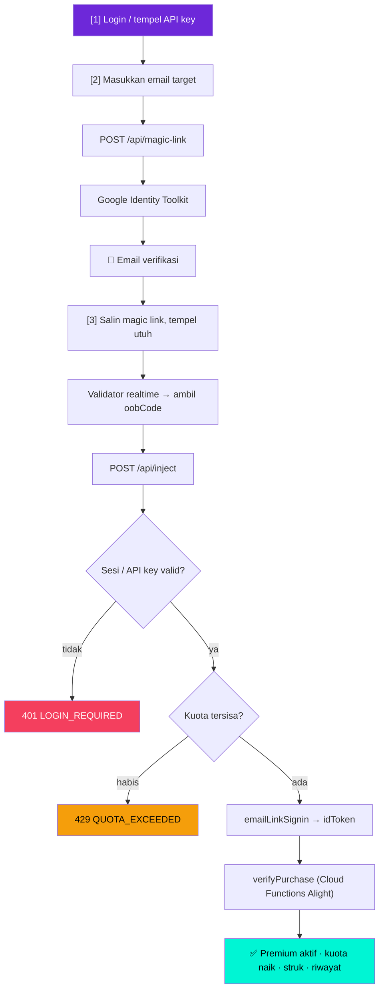
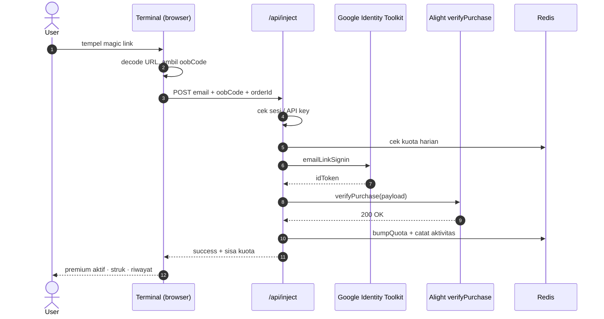

<!-- ═══════════════════════════════════════════════════════════════════ -->
<!--                        A M   P R E M I U M                          -->
<!--                     Z U K A I   T E R M I N A L                     -->
<!-- ═══════════════════════════════════════════════════════════════════ -->


<p align="center">
  <a href="https://www.juikoprem.my.id"></a>
  
  
  
  
  
  
</p>

<p align="center">
  
</p>

```
   ▄▀█ █▀▄▀█   █▀█ █▀█ █▀▀ █▀▄▀█ █ █ █ █▀▄▀█
   █▀█ █░▀░█   █▀▀ █▀▄ ██▄ █░▀░█ █ █ █ █░▀░█
   ─────────────────────────────────────────────
   ZUKAI TERMINAL · v9.0.1 · node asia-se-01 · READY
```

<p align="center">
  <a href="https://www.juikoprem.my.id"><b>🚀 Demo Langsung</b></a> ·
  <a href="#-daftar-isi"><b>📑 Daftar Isi</b></a> ·
  <a href="#-api-reference"><b>🔌 API</b></a> ·
  <a href="#-deploy-sendiri"><b>📦 Deploy</b></a> ·
  <a href="#-faq"><b>❓ FAQ</b></a>
</p>

> **Bukan produk resmi Alight Creative.** Kalau premium tiba-tiba hilang, jalankan ulang prosesnya.

---

## 📑 Daftar Isi

<p align="center">

| # | Bagian | # | Bagian |
|:-:|:--|:-:|:--|
| 1 | [Apa ini](#-apa-ini) | 8 | [Model Data](#️-model-data) |
| 2 | [Spesifikasi](#-spesifikasi) | 9 | [Deploy Sendiri](#-deploy-sendiri) |
| 3 | [Kapabilitas Terminal](#-kapabilitas-terminal) | 10 | [Keamanan](#-keamanan) |
| 4 | [Lab Workspace](#-lab-workspace) | 11 | [Batasan & Status](#️-batasan--status) |
| 5 | [Cara Kerja](#-cara-kerja) | 12 | [Roadmap](#️-roadmap) |
| 6 | [Struktur Proyek](#-struktur-proyek) | 13 | [Changelog](#-changelog) |
| 7 | [API Reference](#-api-reference) | 14 | [FAQ](#-faq) · [Kontribusi](#-kontribusi) · [Lisensi](#-lisensi) |

</p>

---

## 📟 Apa ini

**AM PREMIUM** memangkas alur aktivasi premium manual jadi **dua kolom input dan satu tombol**.

Proses aslinya panjang dan gampang salah: kirim link verifikasi, buka email, salin URL panjang yang berantakan, tempel ke tempat yang benar, baru jalankan. Terminal ini memotong semuanya.

Seluruh logika berat — login OOB, pemanggilan `verifyPurchase`, penyimpanan token, hitung kuota — dipindah ke serverless function. **Prinsip desainnya: satu layar, dua langkah, nol token di frontend.** Kalau satu langkah gagal, terminal bilang persis di mana masalahnya.

Sejak v9.0.0 ada **Lab Workspace**: shell sandbox, downloader multi-platform, proxy media, pembaca manga, pemutar musik, dan temp mail multi-provider — semuanya dalam satu terminal yang sama.

```diff
- Manual   : kirim link → buka email → salin URL → tempel → jalankan → cek berhasil
+ Terminal : ketik email → tempel link → [ INJECT ] → ✅ premium aktif
```

---

## 🧾 Spesifikasi

<table>
<tr><td><b>Developer</b></td><td>Zukai Dev</td></tr>
<tr><td><b>Runtime</b></td><td>Vercel Functions · node <code>asia-se-01</code></td></tr>
<tr><td><b>Stack</b></td><td>HTML + Vanilla JS, tanpa framework, tanpa build step</td></tr>
<tr><td><b>Data</b></td><td>Upstash Redis (REST)</td></tr>
<tr><td><b>Auth</b></td><td>Session JWT cookie <code>HttpOnly</code> · OTP 6 digit · API key <code>x-api-key</code></td></tr>
<tr><td><b>Pembayaran</b></td><td>QRIS via Pixpayz</td></tr>
<tr><td><b>Sandbox</b></td><td>Piston API (bash / node / python / 11 bahasa)</td></tr>
<tr><td><b>Downloader</b></td><td>tikwm · Piped · cobalt · oceansaver · rantai scraper</td></tr>
<tr><td><b>Temp Mail</b></td><td>17 provider, stateless-first + probe + failover</td></tr>
<tr><td><b>Versi</b></td><td>v9.0.1 · Build 2026.11.08</td></tr>
<tr><td><b>Lisensi</b></td><td>Open Source</td></tr>
</table>

---

## ⚡ Kapabilitas Terminal

Dibangun buat dipakai, bukan dipamerin. Tiap bagian punya satu tugas jelas.

<details open>
<summary><b>1. Magic Link Dispatch</b></summary>

Kirim email verifikasi ke akun target lewat `POST /api/magic-link`. Respon langsung, tanpa reload. Rate limit **40 request/jam per IP**.

</details>

<details open>
<summary><b>2. Bulk Antrian</b></summary>

Tempel sampai **30 email** sekaligus, dikirim berurutan dengan jeda 1,2 detik. Status per baris terlihat jelas — sukses, gagal, atau menunggu.

</details>

<details open>
<summary><b>3. Validator Realtime</b></summary>

Tempel link, langsung dicek: `oobCode` ketemu atau tidak, panjang karakter, dan tombol inject menyesuaikan. Parser mendekode URL bersarang dan cuma mengambil nilai `oobCode`.

</details>

<details open>
<summary><b>4. Force Inject</b></summary>

Payload diteruskan ke `POST /api/inject` dengan order ID unik sebagai jejak aktivasi. Butuh sesi login atau API key yang valid.

</details>

<details open>
<summary><b>5. Akun & Kuota Server</b></summary>

Register/login pakai email + password (bcrypt, cost 10) atau OTP 6 digit. Kuota **20 inject/hari** buat akun free, reset **00:00 WIB**. Dihitung di Redis, bukan di browser — nggak bisa diakalin lewat DevTools.

</details>

<details open>
<summary><b>6. Premium & QRIS Otomatis</b></summary>

Upgrade **Rp3.500 / 30 hari**. Invoice dibuat lewat Pixpayz, QR dirender di sheet pembayaran, status di-polling sampai lunas, plan naik otomatis tanpa kirim bukti transfer.

</details>

<details open>
<summary><b>7. API Key buat Bot</b></summary>

Setiap akun punya API key `am_<48 hex>`. Bisa dirotasi dari panel akun. Dipakai sebagai header `x-api-key` buat integrasi mesin.

</details>

<details open>
<summary><b>8. Riwayat Lokal + CSV</b></summary>

Aktivasi tersimpan di `localStorage` perangkat, bisa diekspor CSV buat pembukuan, bisa dihapus kapan saja.

</details>

<details open>
<summary><b>9. Panel Owner</b></summary>

Statistik global, grant premium manual per email, banner pengumuman global, dan saklar maintenance mode.

</details>

<details open>
<summary><b>10. Token di Server</b></summary>

`API_KEY`, `ALIGHT_TOKEN`, `FIREBASE_TOKEN`, `JWT_SECRET`, `PIXPAYZ_API_KEY` hidup sebagai env Vercel. Nol kredensial di HTML.

</details>

### Ekstra terminal

`Ctrl+K` command palette · accent themes (violet / cyan / lime / ember) · sound toggle (Web Audio, tanpa file) · QR share · confetti + particle canvas · navigasi keyboard `↑ ↓ Enter Esc` · order ID acak atau urut · sheet konfirmasi + struk unduhan · mini tools (OOB extractor, Base64, epoch clock) · responsive + reduced-motion.

---

## 🧪 Lab Workspace

Workspace tab terpisah — `Beranda` · `Shell` · `Downloader` · `Media` · `Manga` · `Musik` · `Temp Mail` · `Akun`. Semua lewat **satu** endpoint `/api/lab` dengan rate limit per IP per menit.

| Modul | Isi | Cap / menit |
|:--|:--|:-:|
| **Shell** | Virtual FS, eksekusi `bash` / `node` / `python3` + 11 bahasa lain lewat Piston. Maks 6 file, 40.000 karakter per file, timeout 12 detik | `24` |
| **Downloader** | TikTok, YouTube, Instagram, Facebook, X, Spotify, SoundCloud, Pinterest, Threads, Reddit, Bilibili, Terabox, Pixiv, Xiaohongshu, Apple Music, Bandcamp | `40` |
| **Resolver** | mediafire · pixeldrain · gdrive · catbox · doodstream · safelinku · rekonise · unshorten | `60` |
| **Net** | Fetch URL apa pun sebagai teks (maks 60.000 karakter) buat cek endpoint atau header | `40` |
| **Img** | Proxy gambar + fallback cover Comick + placeholder SVG | `260` |
| **Proxy / HLS** | Rewrite HTML (buang iklan & script), rewrite segmen m3u8, dukung `Range` / `206`, `dl=1` attachment | `1400` |
| **Manga** | MangaDex · Comick · Komikindo · Komiku · Kiryuu · KomikCast · Asura Scans · BacaKomik · ManhwaIndo · MangaBats | `60` |
| **Musik** | iTunes search / chart / album + audio penuh via Piped | `140` |
| **Temp Mail** | Buat alamat, baca inbox, baca isi, hapus — 17 provider dengan failover otomatis | `220` |
| **Health** | Versi, ketersediaan scraper, jumlah Piped, daftar provider mail | `120` |

Sandbox ini yang dipakai buat ngetes alur magic link tanpa harus buka inbox sendiri.

---

## 🔄 Cara kerja



**Order ID** bisa dipakai sebagai penanda transaksi. Mode acak menghasilkan 5 digit random; mode urut dipakai kalau kamu jualan dan butuh ID konsisten.



---

## 🧱 Struktur proyek

```
am-premium/
├── api/
│   ├── admin/
│   │   ├── [action].js       # grant, stats (khusus owner)
│   │   ├── announcement.js   # banner pengumuman global
│   │   └── maintenance.js    # saklar maintenance mode
│   ├── auth/
│   │   └── [action].js       # login, register, me, logout, key, OTP
│   ├── payment/
│   │   └── [action].js       # create, status, history, webhook, confirm
│   ├── health.js             # cek env + versi
│   ├── inject.js             # emailLinkSignin + verifyPurchase
│   ├── lab.js                # exec, dl, resolve, net, img, proxy, manga, music, mail
│   └── magic-link.js         # createAuthUri + getOobConfirmationCode
├── assets/                   # app.js, css, ikon
├── backup                    # snapshot frontend versi lama
├── lib/
│   ├── auth.js               # bcrypt, JWT, cookie, API key, OTP store
│   ├── db.js                 # client Redis + skema key
│   ├── premium.js            # isPremium / isOwner / grantPremium
│   └── quota.js              # limit harian, dayKey WIB
├── index.html                # seluruh frontend: hero, terminal, lab, FAQ, tools
├── package.json              # @upstash/redis, @coflyn/scrapr, bcryptjs, jsonwebtoken
├── vercel.json               # maxDuration 60, includeFiles @coflyn/**
└── README.md
```

Frontend murni satu file. Tidak ada build step, tidak ada bundler, tidak ada framework. Buka `index.html` dan itu sudah seluruh aplikasinya.

> [!WARNING]
> `api/lab.js` sengaja ditulis **CommonJS** (`module.exports`) karena `package.json` tidak punya `"type": "module"`. File lain masih ESM. Jangan campur gaya di file yang sama — kalau nanti mau pindah ke ESM global, `lab.js` harus dikonversi balik dulu.

---

## 🔌 API Reference

Base URL produksi: **`https://www.juikoprem.my.id`** — ganti kalau kamu deploy di alamat lain.

Semua endpoint mengembalikan JSON `{ "status": "success" | "error", "message": "..." }`.

### Autentikasi

| Metode | Header / Cookie | Dipakai untuk |
|:--|:--|:--|
| Session cookie | `amsess` (JWT, `HttpOnly`, `Secure`, 30 hari) | Browser |
| API key | `x-api-key: am_xxxxxxxx` | Bot, script, integrasi server |

Endpoint yang butuh identitas: `/api/inject`, seluruh `/api/auth/*` (kecuali `login`, `register`, `request-code`, `verify-code`), seluruh `/api/payment/*`, seluruh `/api/admin/*`.

### `GET /api/health`

```json
{ "ok": true, "version": "5.1.0",
  "env": { "apiKey": true, "alightToken": true, "firebaseToken": true,
           "redisUrl": true, "redisToken": true, "jwtSecret": true,
           "pixpayz": true, "owner": true } }
```

### Auth

| Endpoint | Body | Hasil |
|:--|:--|:--|
| `POST /api/auth/register` | `{ email, password }` | `200` user + kuota + cookie · `409` dipakai · `400` invalid |
| `POST /api/auth/login` | `{ email, password }` | `200` user + kuota + cookie · `401` salah |
| `POST /api/auth/request-code` | `{ email }` | `200` kode 6 digit dikirim · `429` limit |
| `POST /api/auth/verify-code` | `{ email, code }` | `200` user + cookie · `400` salah/expired · `429` percobaan habis |
| `GET /api/auth/me` | — | `200` `{ user, quota }`, `user: null` kalau tanpa sesi |
| `POST /api/auth/logout` | — | `200`, cookie dihapus |
| `POST /api/auth/key` | — | `200` API key baru, key lama dicabut |

Batas OTP: **3/jam per email**, **10/jam per IP**, **25/hari global**, TTL 10 menit, maks 5 percobaan.

### `POST /api/magic-link`

```json
{ "email": "buyer@email.com" }
```

`200` `{ "status": "success", "message": "Magic Link berhasil dikirim!" }` · `429` di atas 40 req/jam per IP.

### `POST /api/inject`

Login dengan OOB code lalu meneruskan payload ke `verifyPurchase`. CORS mencerminkan origin pemanggil dan mengizinkan credentials.

```json
{ "email": "buyer@email.com", "oobCode": "OOB_CODE_NYA", "orderId": "ZukaiDev-VIP-00001" }
```

| Status | Arti |
|:-:|:--|
| `200` | `{ status: "success", orderId, quota: { remaining } }` |
| `401` | `LOGIN_REQUIRED` |
| `429` | `QUOTA_EXCEEDED` + objek `quota` |
| `500` | kegagalan sisi Google / Alight |

### `GET\|POST /api/lab?action=<action>`

Butuh sesi atau API key. Rate limit per IP per menit di header `x-forwarded-for`.

| Action | Method | Body / Query | Hasil |
|:--|:-:|:--|:--|
| `exec` | POST | `{ lang, files:[{name,content}], stdin }` | `stdout`, `stderr`, `code`, `compile` |
| `dl` | POST | `{ url, format:"mp4"\|"mp3" }` | `items:[{ url, label, type, provider }]` |
| `resolve` | POST | `{ url }` | `url`, `filename`, `size` |
| `net` | GET/POST | `?url=` | `code`, `type`, `body` (maks 60k) |
| `img` | GET | `?url=&ref=&q=` | Biner gambar / placeholder SVG |
| `proxy` \| `hls` | GET | `?url=&ref=&raw=&dl=&name=` | HTML bersih, m3u8 ter-rewrite, atau media |
| `manga` | POST | `{ step, source, q, id, tag }` | `items` / `pages` |
| `music` \| `song` | POST | `{ step, q }` | `items` / `chart` / `albums` |
| `mail` | POST | `{ step, provider, name, domain, address, token, sid, id }` | `domains` / `address` / `messages` / `html` |
| `health` | GET | — | `version`, `scraper`, `piped`, `mail` |

<details>
<summary><b>Detail step tiap modul</b></summary>

- **manga** → `sources` · `home` · `genres` · `bygenre` · `search` · `chapters` · `pages`
- **music** → `home` · `search` · `album` · `full`
- **mail** → `sources` · `check` · `domains` · `new` · `bulk` · `list` · `read` · `del`
- **mail provider** → `plus` · `maildrop` · `inboxes` · `harakirimail` · `moakt` · `mailnesia` · `dispostable` · `onesec` · `yopmail` · `tempmailio` · `tmplol` · `mailtm` · `mailgw` · `dropmail` · `guerrilla` · `smailpro` · `mailsac` · `auto`
- **exec lang** → `bash` `sh` `shell` `node` `js` `python` `python3` `py` `php` `go` `c` `cpp` `java` `ruby` `lua`

</details>

### Payment

| Endpoint | Keterangan |
|:--|:--|
| `POST /api/payment/create` | Invoice QRIS. `401` belum login, `400` sudah premium |
| `GET /api/payment/status?id=` | Status invoice, dipolling sampai `paid` |
| `GET /api/payment/history` | 20 order terakhir milik user |
| `POST /api/payment/webhook` | Callback gateway, memicu grant premium |
| `POST /api/payment/confirm?id=` | Tandai lunas manual (khusus owner) |

Invoice kedaluwarsa setelah 3 hari. Webhook memverifikasi `PIXPAYZ_WEBHOOK_SECRET` lewat header `x-webhook-secret` atau `x-pixpayz-signature`, dan menolak kalau nominal kurang dari harga invoice.

### Admin (khusus owner via `OWNER_EMAIL`)

| Endpoint | Keterangan |
|:--|:--|
| `GET /api/admin/stats` | `{ totalUsers, injectToday }` |
| `POST /api/admin/grant` | `{ email, days }` |
| `GET\|POST\|DELETE /api/admin/announcement` | Banner global |
| `GET\|POST /api/admin/maintenance` | `{ active: true }` |

Akun owner selalu unlimited dan tidak pernah kena kuota.

### Contoh integrasi

**cURL**

```bash
curl -X POST https://www.juikoprem.my.id/api/inject \
  -H 'Content-Type: application/json' \
  -H 'x-api-key: am_xxxxxxxx' \
  -d '{"email":"buyer@email.com","oobCode":"OOB_CODE","orderId":"VIP-00001"}'
```

**Node.js**

```js
await fetch('https://www.juikoprem.my.id/api/inject', {
  method: 'POST',
  headers: { 'Content-Type': 'application/json', 'x-api-key': 'am_xxxxxxxx' },
  body: JSON.stringify({ email, oobCode, orderId: 'VIP-00001' }),
});
```

**Python**

```python
import requests
requests.post("https://www.juikoprem.my.id/api/inject",
  json={"email": email, "oobCode": code, "orderId": "VIP-00001"},
  headers={"x-api-key": "am_xxxxxxxx"})
```

**PHP**

```php
<?php
$c = curl_init('https://www.juikoprem.my.id/api/inject');
curl_setopt_array($c, [
  CURLOPT_POSTFIELDS => json_encode(['email'=>$e,'oobCode'=>$c2,'orderId'=>'VIP-00001']),
  CURLOPT_HTTPHEADER => ['Content-Type:application/json','x-api-key:am_xxxxxxxx'],
  CURLOPT_RETURNTRANSFER => true,
]);
echo curl_exec($c);
```

---

## 🗄️ Model data

Semua state di Redis, key-nya berpola:

| Key | Isi | TTL |
|:--|:--|:-:|
| `user:<id>` | Record user (hash bcrypt, plan, `premiumUntil`, apiKey) | ∞ |
| `email:<email>` | Pemetaan email → id | ∞ |
| `key:<apiKey>` | Pemetaan API key → id | ∞ |
| `quota:<id>:<hari>` | Counter inject harian | 48 jam |
| `quota:global:<hari>` | Counter global buat statistik | 48 jam |
| `order:<invoiceId>` | Invoice Pixpayz | 3 hari |
| `orders:<id>` | Set invoice milik user | 90 hari |
| `acts:<id>` | 100 aktivitas terakhir | ∞ |
| `rl:<prefix>:<ip>` | Rate limit | 1 jam |
| `otp:<email>` | Hash OTP + percobaan + expiry | 10 menit |
| `users:all` | Set seluruh user terdaftar | ∞ |

Batas kuota free memakai offset `+7 jam`, jadi `dayKey` berganti tepat **00:00 WIB**.

---

## 🔑 Environment

<table>
<tr><th>Variable</th><th>Isi</th><th>Wajib</th></tr>
<tr><td><code>API_KEY</code></td><td>Web API key project Firebase Alight Creative</td><td>✅</td></tr>
<tr><td><code>ALIGHT_TOKEN</code></td><td>Purchase token langganan sebagai payload</td><td>✅</td></tr>
<tr><td><code>FIREBASE_TOKEN</code></td><td>Firebase instance ID token</td><td>✅</td></tr>
<tr><td><code>KV_REST_API_URL</code></td><td>URL REST Upstash Redis</td><td>✅</td></tr>
<tr><td><code>KV_REST_API_TOKEN</code></td><td>Token REST Upstash Redis</td><td>✅</td></tr>
<tr><td><code>JWT_SECRET</code></td><td>String acak panjang buat tanda tangan sesi</td><td>✅</td></tr>
<tr><td><code>PIXPAYZ_API_KEY</code></td><td>API key Pixpayz buat invoice QRIS</td><td>✅</td></tr>
<tr><td><code>OWNER_EMAIL</code></td><td>Email owner, pisah koma kalau lebih dari satu</td><td>✅</td></tr>
<tr><td><code>MAILTARGET_API_KEY</code></td><td>Token kirim OTP via Mailtarget</td><td>⚪</td></tr>
<tr><td><code>MAIL_FROM</code></td><td>Pengirim email OTP, default <code>no-reply@juikoprem.my.id</code></td><td>⚪</td></tr>
<tr><td><code>OTP_PEPPER</code></td><td>Pepper hash OTP, fallback ke <code>JWT_SECRET</code></td><td>⚪</td></tr>
<tr><td><code>PIXPAYZ_WEBHOOK_SECRET</code></td><td>Secret verifikasi callback gateway</td><td>⚪</td></tr>
<tr><td><code>PIXPAYZ_API</code></td><td>Base URL gateway, default <code>https://pixpayz.com</code></td><td>⚪</td></tr>
<tr><td><code>COBALT_API</code></td><td>Base URL instance cobalt, pisah koma</td><td>⚪</td></tr>
<tr><td><code>COBALT_KEY</code></td><td>API key cobalt</td><td>⚪</td></tr>
<tr><td><code>PREMIUM_PRICE</code></td><td>Harga premium, default <code>3500</code></td><td>⚪</td></tr>
<tr><td><code>PREMIUM_DAYS</code></td><td>Durasi premium, default <code>30</code></td><td>⚪</td></tr>
<tr><td><code>FREE_DAILY_LIMIT</code></td><td>Limit harian akun free, default <code>20</code></td><td>⚪</td></tr>
<tr><td><code>MAILSAC_KEY</code></td><td>API key Mailsac</td><td>⚪</td></tr>
</table>

Semuanya wajib hidup di server. Jangan pernah ditaruh di `index.html`. **Ganti `JWT_SECRET` sebelum produksi.**

---

## 🚀 Deploy sendiri

Butuh akun [Vercel](https://vercel.com/), database [Upstash Redis](https://upstash.com/), dan akun Pixpayz.

```bash
git clone https://github.com/kyedeveloper/am-premium.git
cd am-premium
```

1. Import repo di dashboard Vercel — framework preset **Other**, tanpa build command.
2. Set semua env di **Settings → Environment Variables**.
3. Deploy:

```bash
vercel --prod
```

4. Verifikasi: buka `https://domain-kamu/api/health` — semua field `env` harus `true`, lalu `https://domain-kamu/api/lab?action=health` harus `200`.
5. Kalau pakai domain sendiri, ganti `https://www.juikoprem.my.id` di contoh kode dan panel API pada `index.html`.

---

## 🔐 Keamanan

- Password di-hash bcrypt cost 10, tidak pernah dikembalikan ke client.
- Sesi JWT `HttpOnly` + `Secure` + `SameSite=Lax`, umur 30 hari.
- OTP disimpan sebagai hash SHA-256 + pepper, sekali pakai, TTL 10 menit.
- Token Alight & Firebase tidak pernah menyentuh browser.
- Kuota dihitung di server, per user per hari.
- `/api/magic-link` dibatasi 40 request/jam per IP; `/api/lab` dibatasi per action per menit.
- API key bisa dicabut seketika lewat rotasi.
- Endpoint `/api/admin/*` dijaga `isOwner`, bukan cuma cek login.
- CORS mengizinkan credentials hanya untuk origin pemanggil, dengan header `Vary: Origin`.

---

## ⚠️ Batasan & Status

- Bukan produk resmi **Alight Creative** dan tidak berafiliasi dengan mereka.
- Bergantung penuh pada skema `identitytoolkit` Google dan endpoint `verifyPurchase` milik Alight. Perubahan di sisi mereka bisa mematahkan alur sampai kode diperbarui.
- `ALIGHT_TOKEN` punya masa berlaku; kalau aktivasi mulai gagal konsisten, itu kandidat pertama yang perlu diganti.
- Lab bergantung pada layanan pihak ketiga (Piston, tikwm, Piped, cobalt, penyedia temp mail). Kalau satu tumbang, modul itu ikut tumbang.
- Riwayat aktivitas sisi browser hilang kalau `localStorage` dibersihkan atau ganti perangkat.
- `api/admin/announcement.js` dan `api/admin/maintenance.js` masih memakai `@vercel/kv` yang belum masuk `package.json`, dan belum punya pengecekan `isOwner` — siapa pun bisa menembak endpoint itu.
- `api/payment/[action].js` punya satu kurung kurawal berlebih di akhir file, dan memanggil `grantPremium(user, days)` padahal signature-nya `grantPremium(userId, days)` — webhook perlu dikoreksi sebelum pembayaran otomatis bisa dipercaya.

---

## 🗺️ Roadmap

- [x] Validator OOB realtime + antrian bulk
- [x] Rate limiter per IP
- [x] OTP 6 digit via email
- [x] Workspace Lab (shell, downloader, manga, musik, temp mail)
- [x] Konversi `api/lab.js` ke CommonJS yang bisa di-load Vercel
- [ ] Rapikan kurung kurawal `payment/[action].js`
- [ ] Perbaiki `grantPremium` di alur webhook
- [ ] Samakan client KV di seluruh endpoint admin + tambah `isOwner`
- [ ] Sinkronisasi riwayat lintas perangkat lewat Redis
- [ ] Retry terpisah per baris pada antrian bulk
- [ ] Webhook keluar setelah inject sukses
- [ ] Panel owner untuk rotasi token
- [ ] Dukungan produk selain `am.full.sub.annual.19q4`

---

## 📜 Changelog

| Versi | Tanggal | Isi |
|:--|:--|:--|
| **v9.0.1** | 8 Nov 2026 | `lab.js` jadi CommonJS, fix syntax provider `plus`, modul manga & musik |
| v9.0.0 | 8 Nov 2026 | Lab v2: manga, musik, img proxy, proxy HLS, 17 provider temp mail |
| v8.0.0 | 5 Nov 2026 | Rebrand VESPERA, OTP login, payment API v8 |
| v1.3.0 | 1 Nov 2026 | Workspace Lab — shell sandbox, downloader, temp mail |
| v1.2.0 | 1 Nov 2026 | Integrasi Mailtarget, SDK multi-bahasa |
| v1.1.0 | 25 Okt 2026 | Rate limiter, antrian bulk |
| v1.0.0 | 10 Okt 2026 | Relaunch core serverless |

---

## ❓ FAQ

<details>
<summary><b>Ini legal atau bukan?</b></summary>

Metodenya meniru alur verifikasi pembelian dari aplikasi resmi, jadi akun akan terbaca premium di Alight Motion. Risikonya cuma satu: kalau server Google atau Alight mengubah skema, endpoint bisa berhenti sampai diperbaiki.

</details>

<details>
<summary><b>Kenapa ada limit 20x sehari?</b></summary>

Biar server nggak kebanjiran dan biaya token tetap wajar. Reset 00:00 WIB. Butuh lebih? Premium Rp3.500 sebulan tanpa batas.

</details>

<details>
<summary><b>Premium aktif otomatis setelah bayar?</b></summary>

Ya, begitu QRIS dibayar, status berubah dalam beberapa detik. Halaman pembayaran mengecek sendiri. Kalau macet, owner bisa menandai lunas manual lewat `payment/confirm`.

</details>

<details>
<summary><b>Email magic link nggak masuk, kenapa?</b></summary>

Cek spam/promosi, tunggu 1–2 menit, kirim ulang. Pastikan email diketik lengkap tanpa spasi. Beberapa domain kantor memblokir pengirim pihak ketiga.

</details>

<details>
<summary><b>Link yang ditempel bentuknya aneh, masih bisa?</b></summary>

Bisa. Parser mendekode URL, membuka parameter bersarang, dan mengambil nilai `oobCode` saja.

</details>

<details>
<summary><b>Data email saya disimpan?</b></summary>

Email akun disimpan di database untuk login dan hitung kuota. Riwayat aktivasi tetap di `localStorage` dan bisa dihapus kapan saja.

</details>

<details>
<summary><b>Bisa dipakai buat jualan?</b></summary>

Itu tujuan fitur antrian dan order ID urut. Pakai mode **Urut** dan ekspor riwayat sebagai CSV untuk pembukuan.

</details>

<details>
<summary><b>Bisa dipanggil dari bot?</b></summary>

Ya, pakai header `x-api-key`. Rate limit dan retry tetap tanggung jawab sisi kamu.

</details>

---

## 🤝 Kontribusi

1. Fork repo
2. `git checkout -b fitur/nama-fitur`
3. `git commit -m "tambah: ..."`
4. `git push origin fitur/nama-fitur`
5. Buka Pull Request

Frontend satu file — jaga gaya kode tetap konsisten dan jangan pernah menaruh token di HTML.

---

## 📄 Lisensi

Open Source. Lihat isi repo untuk ketentuan pemakaian. Kredit ke **Zukai Dev** kalau kamu fork atau pakai ulang.

---

<p align="center">
  
</p>

<p align="center">
  <code>zukai_kernel v9.0.1</code> · <code>mount /api/magic-link</code> <b>OK</b> · <code>mount /api/inject</code> <b>OK</b> · <code>mount /api/lab</code> <b>OK</b> · <code>auth + quota module</code> <b>OK</b> · <code>node asia-se-01</code> <b>14ms</b> · <b>READY</b>
</p>

<p align="center">
  <sub>© 2026 ZUKAI DEVELOPER · Bukan produk resmi Alight Creative</sub>
</p>